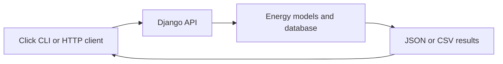

# EUROgroup Energy App

A Django backend and Click command-line client for querying electrical-energy data, developed for the NTUA Software Engineering course.

## Supported workflows

- Actual total load by area and time resolution.
- Aggregated generation by production type.
- Day-ahead load forecasts.
- Actual-versus-forecast comparisons.
- JSON and CSV responses, with date/month/year query options.



## Repository guide

| Directory | Contents |
| --- | --- |
| `backend/eurogroup/` | Django configuration and routing |
| `backend/energy/` | Models, views, forms and management commands |
| `backend/energy/migrations/` | Recorded database migrations |
| `cli/` | Click client and package setup |

## Local setup status

This is a legacy coursework snapshot. There is no complete pinned backend environment or bundled energy dataset. Reconstruct compatible dependencies and database configuration before running it. Configure fresh local credentials before running it. Previously committed credentials require revocation or replacement wherever they were used; removing a file from the current tree does not remove it from Git history.

Once the backend environment and database are prepared:

```bash
cd backend
python manage.py runserver 8765
```

Install the CLI from its directory in a suitable Python environment:

```bash
cd cli
python -m pip install -e .
energy_group044 --help
```

Both `cd` commands above are relative to the repository root. The CLI setup declares Click; inspect its imports for additional runtime dependencies. The [original command reference](CLI_GUIDE.md) preserves query examples and course context.

## Validation and limitations

Unit and functional test files are present in both components. Their database, user and server prerequisites must be configured before execution. Authentication, compatibility and a clean-database reproduction have not been newly verified. This repository is useful for reviewing API/CLI structure, not as a ready-to-deploy energy service.
